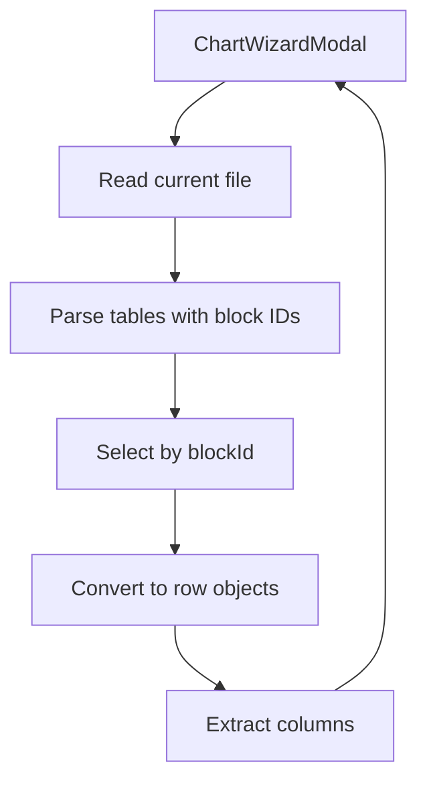

# Markdown Table Data Source Plan

## Context

- The wizard currently supports only `manual` and `csv` data sources and builds the column-selection UI from parsed CSV data (`[src/components/ChartWizardModal.tsx](src/components/ChartWizardModal.tsx)`).
- Chart configs are parsed in `loadFromFile`, which currently routes string data to `wordcount:`, `dataviewjs:`, or CSV filename parsing (`[src/parser.ts](src/parser.ts)`).

## Approach

- Add a Markdown-table parser utility that:
  - Reads a Markdown file (current note only, per your choice).
  - Extracts tables that are immediately followed by a block ID line.
  - Finds the table matching a chosen block ID.
  - Converts it into an array of row objects (headers → values).
- Wire the wizard to expose a new data source (e.g., `md-table`) and to:
  - Allow choosing a block ID from the current file.
  - Build column lists and preview data in the same shape as CSV so existing selection UI logic can be reused.
- Optionally extend the config parser so YAML-based charts can reference a block-id table (e.g., `mdtable:^id`), reusing the same parser.

## Key File Changes

- `[src/components/ChartWizardModal.tsx](src/components/ChartWizardModal.tsx)`
  - Add `md-table` to `DataSource` and `DATA_SOURCE_LABELS`.
  - Add UI for selecting a block ID from current file.
  - Use new table parser to fill `csvPreviewData`-like structure and `csvColumns`.
  - Reuse existing column selection UX for labels/values/series.
- `[src/tools.ts](src/tools.ts)` (or new helper file)
  - Implement `parseMarkdownTableByBlockId(...)` that returns row objects and available column names.
- `[src/parser.ts](src/parser.ts)`
  - Extend `loadFromFile` to accept an explicit Markdown-table reference (e.g., `mdtable:^blockId`) and return parsed rows.

## Risks/Edge Cases

- Tables without a valid header row or inconsistent column counts.
- Block ID line with extra whitespace; normalize safely.
- Empty tables should surface clear errors in the wizard.

## Validation

- Manual test in Obsidian:
  - Add multiple tables in a note, only some with block IDs.
  - Open Chart Wizard → select `Markdown Table` → choose a block ID.
  - Verify preview data and column pickers behave like CSV.

## Mermaid (Data Flow)

